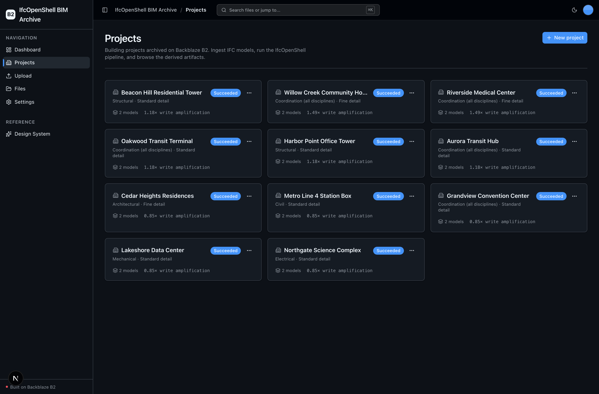
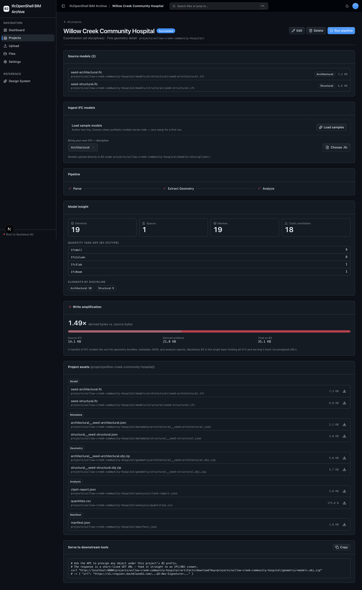

<!-- last_verified: 2026-08-13 -->
# IfcOpenShell BIM Archive

A full-stack **BIM digital-twin archive** for architecture, engineering, and construction (AEC) teams. Create a **Project** for one building or coordination effort, ingest discipline-specific **IFC** models, and run **[IfcOpenShell](https://github.com/IfcOpenShell/IfcOpenShell)** locally to parse the entity tree, extract geometry to OBJ meshes, and analyze the model (quantity take-off + clash candidates). Every source model and every derived artifact is archived on **[Backblaze B2](https://www.backblaze.com/cloud-storage?utm_source=github&utm_medium=referral&utm_campaign=ai_artifacts&utm_content=b2ai-ifcopenshell-bim-archive)** over the S3-compatible API and indexed by a per-project `manifest.json`.

The headline is **write amplification**: a handful of IFC models fan out into geometry bundles, metadata JSON, and analysis reports whose total footprint meets or exceeds the source bytes — and B2 is the single storage layer that holds all of it and serves it back to viewers and coordination tools via presigned URLs.

IfcOpenShell runs as a local, keyless, CPU-only native Python wheel — **the only secret you need is your B2 credentials.** No GPU, no second API key, ~$0 to run a full demo.

<!-- labs-project-page -->

Explore the official [Backblaze B2 AI integrations and sample applications](https://www.backblaze.com/cloud-storage/b2-ai-integrations?utm_source=github&utm_medium=referral&utm_campaign=ai_artifacts&utm_content=b2ai-ifcopenshell-bim-archive) directory and the checked-in [local OpenAPI contract](docs/api/openapi.json).

**What you get out of the box:**
- **Projects** — create/browse/edit/delete building projects; each is a B2 prefix indexed by its own `manifest.json` (no database).
- **IfcOpenShell pipeline** — Parse → Extract Geometry → Analyze, run in an isolated subprocess with a hard timeout so a heavy native pass can't wedge the API.
- **Write-amplification archive** — per-project and archive-wide source-vs-artifact bytes and ratio, all measured live from B2.
- **Full-bucket File Explorer + drag-and-drop Upload** — the reusable B2-backed scaffolding, kept from the starter (Upload doubles as project ingest).
- FastAPI backend with strict layered architecture and structural tests; agent-optimized docs.

## What it looks like

**Projects** — a library of building projects, each a B2 prefix with its own manifest:



**Project detail** — the Parse → Extract Geometry → Analyze pipeline, model insight, write amplification, and the project-scoped asset explorer:



> **Deploy your own in one click** → [Deploy to Vercel](#deploying-to-vercel). One project, one origin, no CORS to wire up.

## Quick Start

You need: Node.js >= 20, pnpm >= 9, Python >= 3.12, and a free **[Backblaze B2 account](https://www.backblaze.com/cloud-storage?utm_source=github&utm_medium=referral&utm_campaign=ai_artifacts&utm_content=b2ai-ifcopenshell-bim-archive)**. No GPU is required — IfcOpenShell is CPU-only, and its prebuilt wheel installs with the other Python dependencies.

### Setup

**1. Run setup**

```bash
pnpm run setup
```

This copies `.env.example` to `.env` only when `.env` does not already exist, installs workspace dependencies from `pnpm-lock.yaml`, creates `services/api/.venv` if missing, validates that an existing venv uses Python 3.12+, and installs the API's committed Python 3.12 resolution (including IfcOpenShell) from `services/api/requirements.lock`. It is safe to rerun and never overwrites an existing `.env`.

> Use the `pnpm run` form: `setup` (like `doctor`) is a built-in pnpm command before pnpm 11, so bare `pnpm setup` would run pnpm's own command instead of this script.

**2. Add your B2 credentials**

Open `.env` in your editor. Then head to the [Backblaze B2 dashboard](https://www.backblaze.com/cloud-storage?utm_source=github&utm_medium=referral&utm_campaign=ai_artifacts&utm_content=b2ai-ifcopenshell-bim-archive) and:

1. **Create a bucket** and note its name and region:
   - **Bucket Unique Name** → `B2_BUCKET_NAME`
   - **Region** (e.g. `us-west-004`, from the endpoint `s3.us-west-004.backblazeb2.com`) → `B2_REGION`
2. **Create an application key** with `Read and Write` permission:
   - **keyID** → `B2_APPLICATION_KEY_ID`
   - **applicationKey** → `B2_APPLICATION_KEY` *(only shown once — paste it now)*

The S3 endpoint is derived from `B2_REGION` (`https://s3.<region>.backblazeb2.com`), so you set the region, not a URL.

> Want a walkthrough? See the docs for [creating a bucket](https://www.backblaze.com/docs/cloud-storage-create-and-manage-buckets) and [creating app keys](https://www.backblaze.com/docs/cloud-storage-create-and-manage-app-keys).

**3. Run it**

```bash
pnpm dev
```

Frontend at `localhost:3000`, API at `localhost:8000`. Interactive API docs (Swagger UI) are at `localhost:8000/docs`, with ReDoc at `/redoc`.

`pnpm dev` runs the preflight check first — it catches the common setup gotchas (wrong Node/Python version, missing venv, missing or placeholder `.env`, ports already taken) and tells you exactly how to fix each one. Run it standalone any time with `pnpm run doctor`.

### Run a full pipeline in three clicks

1. Open **Projects** → **New project** (pick a discipline and geometry detail — both default to sensible values).
2. On the project page, click **Load samples** — the API authors two tiny, license-clean synthetic IFC models (architectural + structural) server-side and archives them under `projects/<slug>/models/`. (Or bring your own `.ifc`.)
3. Click **Run pipeline**. IfcOpenShell parses each model, meshes its geometry to OBJ, and analyzes quantities + clash candidates; the derived artifacts land on B2 and the write-amplification panel fills in.

### Supported local environments

Local scripts run on macOS, Linux, and WSL2 — native Windows isn't supported yet (the dev scripts use POSIX shell syntax), so use WSL2 on Windows. IfcOpenShell ships prebuilt wheels for macOS (arm64) and Linux on CPython 3.12. See [docs/dev-workflows.md](docs/dev-workflows.md) for sandbox, port-fallback, and IPv6 behavior.

## B2 key layout

Every object lives under a per-project prefix, so the manifest, the scoped asset explorer, and write amplification are all clean:

```
projects/<slug>/models/<discipline>/<file>.ifc   # source IFC (ingest)
projects/<slug>/metadata/<model>.json            # parsed entity-tree metadata
projects/<slug>/geometry/<model>.obj.zip         # OBJ mesh bundle
projects/<slug>/analysis/quantities.csv          # quantity take-off
projects/<slug>/analysis/clash-report.json       # bounding-box clash candidates
projects/<slug>/manifest.json                    # canonical per-project index
```

## When to use

Use this repository when you want a working, extensible reference for archiving large BIM/IFC model sets — and their heavy derived artifacts — on Backblaze B2, with a real local processing engine (IfcOpenShell) rather than a stub. It is a strong fit for AEC data engineers, BIM managers, and AI/dev teams evaluating B2 as the long-term store for model archives with heavy derived-artifact fan-out.

## When not to use

Do not choose this repository expecting a complete hosted SaaS product or a production BIM coordination platform. It does not provide managed hosting, user accounts, authentication, tenant isolation, billing, or on-call operations. The clash detection is an axis-aligned bounding-box *candidate* pass for demonstration — not a substitute for a full BIM clash-detection engine. Before using an adapted application in production, you own its product-specific security, operations, capacity, compliance, and support decisions.

## Why Backblaze B2?

[Backblaze B2](https://www.backblaze.com/cloud-storage?utm_source=github&utm_medium=referral&utm_campaign=ai_artifacts&utm_content=b2ai-ifcopenshell-bim-archive) is the object storage this app is built around — a deliberate default, not just a demo backend:

- **S3-compatible API.** B2 speaks the S3 API, so the `boto3` calls, SDKs, and tooling you already use for AWS S3 work unchanged — you just point them at B2's endpoint. This app uses the S3-compatible API throughout (isolated in `services/api/app/repo/`), so nothing is locked to a proprietary client.
- **Built for write-amplifying, data-heavy apps.** A BIM archive turns a few megabytes of source IFC into geometry bundles, metadata JSON, and analysis reports many times larger. B2 storage runs at a fraction of hyperscaler pricing with generous free egress to many CDN and compute partners — exactly what a fan-out archive needs.
- **Free to start.** A [free B2 account](https://www.backblaze.com/cloud-storage?utm_source=github&utm_medium=referral&utm_campaign=ai_artifacts&utm_content=b2ai-ifcopenshell-bim-archive) is enough to run everything in this repo.

## Core Features

- [Projects](docs/features/projects.md) — the project library and lifecycle (create/read/edit/delete/run), backed by per-project manifests on B2.
- [IFC pipeline](docs/features/ifc-pipeline.md) — Parse → Extract Geometry → Analyze, run in an isolated IfcOpenShell subprocess.
- [Write amplification](docs/features/write-amplification.md) — per-project and archive-wide source-vs-artifact accounting.
- [Clash & quantities](docs/features/clash-quantities.md) — quantity take-off + bounding-box clash candidates.
- [Metadata Extraction](docs/features/metadata-extraction.md) — IFC-header + entity-tree parsing (plus image/PDF metadata for reference assets).
- [File Browser](docs/features/file-browser.md) — full-bucket explorer, plus the project-scoped asset explorer.
- [File Upload](docs/features/file-upload.md) — drag-and-drop upload; doubles as project ingest.
- [Dashboard](docs/features/dashboard.md) — archive-wide write amplification, project/model/artifact counts, plus upload stats.
- [Design System](docs/design-system.md) — tokens, primitives, and inline `ErrorState` / `EmptyState` patterns. Live preview at `/design`.

## Tech Stack

- TypeScript, Next.js 16, React 19, Tailwind v4, shadcn/ui, Recharts
- TanStack Query — caching, dedup, retry, stale-while-revalidate for every fetch
- Python 3.12+, FastAPI, boto3, Pydantic v2, **IfcOpenShell** (+ numpy/shapely), Pillow, PyPDF2
- Backblaze B2 (S3-compatible object storage)
- pnpm workspaces (monorepo)

## Commands

| Command | What it does |
|---------|-------------|
| `pnpm run setup` | One-time cold start: copy `.env.example` → `.env` (only if missing), install workspace deps, create the backend venv, install locked API deps (incl. IfcOpenShell) |
| `pnpm dev` | Start frontend + backend (runs the `pnpm run doctor` preflight first) |
| `pnpm verify` | Credential-free pre-PR suite — runs `check:agent-docs`, `verify:api`, then `verify:web` |
| `pnpm verify:full` | `pnpm verify` plus Playwright E2E; needs a live local stack, real `.env`, free port 3000, and Chromium |
| `pnpm contract:export` / `pnpm contract:check` | Export / verify the FastAPI OpenAPI contract in `docs/api/openapi.json` |

`pnpm verify` is the gate to run before opening a PR. It needs `services/api/.venv` from `pnpm run setup`, but no B2 credentials or browser, and it breaks down into `pnpm verify:api` (backend lint, tests, structure), `pnpm verify:web` (frontend lint, unit tests, typecheck + build), and `pnpm check:agent-docs` (agent-doc drift).

For the full command reference (`dev:web`, `dev:api`, `lint`, `test:*`, `check:structure`, `test:e2e`, live B2 tests), plus worktree/parallel-run notes and slow-run recovery, see [docs/dev-workflows.md](docs/dev-workflows.md). You can regenerate the checked-in synthetic seed models with `services/api/.venv/bin/python scripts/make_seed_ifc.py`.

## Deploying to Vercel

Deploys as **one Vercel project** — the Next.js web app and FastAPI API build from the same repo and share one origin (web at `/`, API under `/api`), so there's **no CORS and no second URL to wire up**.

[](https://vercel.com/new/clone?repository-url=https%3A%2F%2Fgithub.com%2Fbackblaze-b2-samples%2Fifcopenshell-bim-archive&project-name=ifcopenshell-bim-archive&repository-name=ifcopenshell-bim-archive&demo-title=IfcOpenShell%20BIM%20Archive&demo-description=BIM%20digital-twin%20archive%20on%20Backblaze%20B2%20powered%20by%20IfcOpenShell.&env=B2_APPLICATION_KEY_ID,B2_APPLICATION_KEY,B2_BUCKET_NAME,B2_REGION&envDescription=B2%20credentials%2C%20bucket%2C%20and%20region&envLink=https%3A%2F%2Fgithub.com%2Fbackblaze-b2-samples%2Fifcopenshell-bim-archive%2Fblob%2Fmain%2Finfra%2Fvercel%2FREADME.md)

Set your B2 credentials, bucket, and region, and you're live. Uploads go **directly from the browser to B2** (presigned PUT), so Vercel's 4.5 MB payload limit doesn't apply. Two things to know before a real deploy:

- Your bucket's CORS must allow the deploy origin (see `services/api/scripts/setup_b2_cors.py`).
- The deployed API is unauthenticated and bucket-wide — use a dedicated B2 bucket/prefix and key for any preview.

Full setup — variable reference, the two-Projects alternative, security, preview/production, `/health` checks, and rollback — is in the [Vercel delivery contract](infra/vercel/README.md).

## Documentation Map

| Doc | Purpose |
|-----|---------|
| [AGENTS.md](AGENTS.md) | Agent table of contents — start here |
| [ARCHITECTURE.md](ARCHITECTURE.md) | System layout, layering, data flows |
| [docs/features/](docs/features/) | Feature docs (projects, IFC pipeline, write amplification, clash & quantities, browser, upload, dashboard, metadata) |
| [docs/app-workflows.md](docs/app-workflows.md) | User journeys |
| [docs/dev-workflows.md](docs/dev-workflows.md) | Engineering workflows and testing |
| [docs/SECURITY.md](docs/SECURITY.md) | Security principles |
| [docs/RELIABILITY.md](docs/RELIABILITY.md) | Reliability expectations |
| [docs/api/openapi.json](docs/api/openapi.json) | Checked contract for the local FastAPI API |
| [infra/vercel/README.md](infra/vercel/README.md) | Vercel deployment contract |

## FAQ

**What is the IfcOpenShell BIM Archive?**
An open-source, full-stack app (Next.js 16 + FastAPI) that archives IFC building models and their derived artifacts on [Backblaze B2](https://www.backblaze.com/cloud-storage?utm_source=github&utm_medium=referral&utm_campaign=ai_artifacts&utm_content=b2ai-ifcopenshell-bim-archive). You create projects, ingest IFC models, and run IfcOpenShell locally to parse, mesh, and analyze them.

**What does "write amplification" mean here?**
A few megabytes of source IFC fan out into geometry OBJ bundles, metadata JSON, and analysis reports whose total footprint meets or exceeds the source. The app measures the ratio per project and archive-wide — B2 is the single layer holding source and derived data.

**Do I need a GPU or an API key besides B2?**
No. IfcOpenShell is a local, keyless, CPU-only native Python wheel. The only secret is your B2 application key. A full demo run costs ~$0 (local compute + a few MB of B2 storage).

**Is it free?**
Yes. The code is MIT-licensed (see [License](#license)), and Backblaze B2 offers a free account to get started.

**Can I use it in production?**
It's a template/sample Backblaze maintains to help developers get started with B2. Production use is possible with caution and requires your own validation — you own the product-specific security, operations, capacity, compliance, and support decisions for anything you adapt, and the repository software carries no SLA. See [When not to use](#when-not-to-use) and [Maintenance and support](#maintenance-and-support).

**Does it include authentication, user accounts, or multi-tenant isolation?**
No. It does not provide managed hosting, user accounts, authentication, tenant isolation, billing, or on-call operations. Add whatever your application requires on top of the scaffold.

**Do I have to use Backblaze B2?**
It integrates Backblaze B2 through the S3-compatible API, and B2 is the storage the app is built around. You supply your own B2 bucket and application key during setup.

**Can I bring my own IFC models?**
Yes. Each project has a project-scoped ingest that presigns a direct browser→B2 PUT under `projects/<slug>/models/<discipline>/`. The "Load samples" button is just a zero-setup convenience.

**Does the geometry export support GLTF?**
Today it extracts pure-Python-serializable **OBJ** meshes (bundled as a zip). GLTF is a reasonable extension, not a current claim.

**Where do I get help or report bugs?**
Report repository defects and feature requests through [GitHub Issues](https://github.com/backblaze-b2-samples/ifcopenshell-bim-archive/issues). For B2 account, billing, service, or API help, use [Backblaze Support](https://www.backblaze.com/help).

## Maintenance and support

Backblaze maintains this open-source template/sample to help developers get started with B2. Production use is possible with caution and requires your own validation. Report repository defects and feature requests through [GitHub Issues](https://github.com/backblaze-b2-samples/ifcopenshell-bim-archive/issues); for B2 account, billing, service, or API help, use [Backblaze Support](https://www.backblaze.com/help). This template/sample is not covered by the Backblaze service level agreement, and no SLA is provided for the repository software; any B2 service or support commitments are governed separately by the applicable Backblaze terms and support plan.

## Contributing

Start with [AGENTS.md](AGENTS.md). It's the map — everything else is discoverable from there. For local commit hooks, follow [the pre-commit workflow](docs/dev-workflows.md#pre-commit).

## License

MIT License - see [LICENSE](LICENSE) for details.
